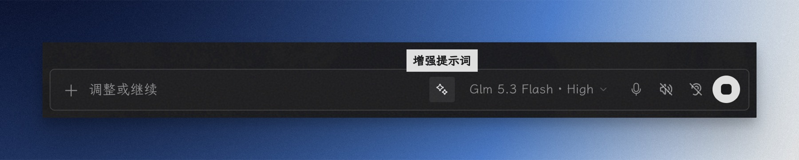

# Prompt Enhancer for Hermes

  

【Hermes 桌面端插件】输入框里的 ✨ 按钮：先把草稿的错别字修干净，再改写成结构化完整提示词。en / 简中 / 繁體。



## 先确认你装的是哪一版

官方目录和本仓库发的**不是同一份代码**，功能不一样，先对号：

| 来源 | 版本 | 点一下会做什么 | ⌘ 选模型 | 升级方式 |
|---|---|---|---|---|
| 官方插件目录<br>`hermes plugins install prompt-enhancer` | **1.6.1**<br>（1.7.1 的 bump 在审核：[#145027](https://github.com/NousResearch/hermes-agent/pull/145027)） | 直接增强，没有修复步骤 | ✗ | `hermes plugins update prompt-enhancer` |
| 本仓库 main<br>Git 安装 ／ 手动放置 | **1.8.5** | 先修复、再增强 | ✓ | 重装 + 勾「强制重装」 |

一句话记住差别：**目录条目钉在某个已评审的 commit 上，所以永远慢一截**。下文中标 `〔1.7〕`〔1.8〕的功能，目录用户要等对应 bump 合并才拿得到。

各版本差在哪：

- **1.6.1**（目录现在这版）：单步增强，错字修复写在增强模板里，改得对不对看不见
- **1.7.0 / 1.7.1**：拆成「修复 → 增强」两次独立调用，修复结果写回输入框可见；⌥ 点击只修复
- **1.8.0**（本仓库）：⌘ 点击选增强模型（本次 / 默认），菜单内一条「恢复默认」
- **1.8.1**：多 profile 路由修正（模型目录按会话所属 profile 拉，裸请求也落在该 profile）、输出上限按输入长度自适应、取消后不再重试、跨窗口同步默认值
- **1.8.2**：菜单里提前说明「换模型要等 Hermes 更新」（1.8.3 把这句改成大白话），按钮补 `aria-haspopup/aria-expanded`，新草稿不再误清本次选择
- **1.8.3 / 1.8.4**：提示文案去掉「宿主 / 回落 / 辅助路由 / 默认路由」这类黑话，统一说「还不能换模型，用默认模型」
- **1.8.5**：概念收回成「一个模型」——修字和重写共用同一个选择，删掉「仅增强」「修复路由」的说法

> 目录实际版本以插件卡片显示为准；本页写于 2026-10-28。

## 它做什么

输入框控件行最左（模型选择器左侧）多一个 ✨：

- **点一下**：草稿先被校对（错别字、同音词误换、语音口误），修好的样子**原地写回输入框**给你看见；紧接着重写成「任务 / 范围 / 约束 / 输出形式」齐备的提示词。〔1.7〕
- **再点一下**（图标变成 ↩）：回到你原来打的那版，错别字也一并回来。只有一层，不经过中间态。
- **只改装写、不回答问题**：不替你执行任务，只把意图整理成 AI 更好执行的提示词。无状态调用，不进会话历史，不影响 prompt cache。语言跟随输入（英文输入 → 英文输出，混排保持混排）。

第一步（修复）是独立调用：**增强失败时你手里仍是一份干净的草稿**。

## 安装

三种方式，按需要的版本选：

| 方式 | 怎么做 | 装到哪版 | 装完还要做什么 |
|---|---|---|---|
| **官方目录** | `hermes plugins install prompt-enhancer` | 1.6.1 | ⌘Q 重开 → 到 **技能与工具 → 插件 → Prompt Enhancer** 打开它 |
| **从 Git 安装**（要 1.8.0 用这个） | 对 Hermes 说：`从 Git 安装这个桌面插件：https://github.com/Heybinshao/prompt-enhancer，安装好后并打开插件`<br>或点「技能与工具 → 插件」页面上方的「从 Git 安装」 | 仓库当前提交 | 同上；升级 = 重装并勾「强制重装」 |
| **手动放置** | 下载 [`desktop/plugin.js`](desktop/plugin.js) → 放到 `~/.hermes/desktop-plugins/prompt-enhancer/plugin.js` | 你下载的那份 | ⌘Q 重开即可（这份不受包管理，默认就是开的） |

**装完按钮没出现**：几乎都是没打开。包管理安装（目录 / Git）的桌面副本默认是关的——不加载、也不报错，只是静默不出现，去 **技能与工具 → 插件 → Prompt Enhancer** 点亮。

> ⚠️ 插件入口在仓库的 `desktop/` 子目录里，别把整个仓库 clone 进 `~/.hermes/desktop-plugins/`——多出一层目录，Hermes 就找不到入口文件了。

**卸载**：在「技能与工具 → 插件」里关掉开关；彻底删是 `hermes plugins remove prompt-enhancer` + 删 `~/.hermes/desktop-plugins/prompt-enhancer/`（两个地方都要清，只删后者会留下后端条目）。

## 使用

| 动作 | 现在会发生什么 | 版本 |
|---|---|---|
| 点 ✨ | 修复草稿 → 重写成结构化提示词 | 〔1.7〕两步；1.6.1 只有增强 |
| 再点一次（↩） | 恢复你打的原版（含错别字） | 全部 |
| ⌥ 点击 ✨ | **只修复，不增强**——适合只想清错字的时候 | 〔1.7〕 |
| ⌘ 点击 ✨ | **打开模型菜单**，选这个按钮用的模型（本次 / 默认） | 〔1.8〕 |
| 转圈时点一下 | 取消（迟到的结果自动丢弃） | 全部 |
| 等待期继续打字 | 不覆盖你的手改，提示「草稿已变动」 | 全部 |
| 空输入框点 ✨ | 提示没有可增强的内容 | 全部 |
| 发送消息后 | 按钮自动回到空闲态 | 全部 |

- **⌥ 只在空闲态生效**：已修复 / 已增强 / 转圈中时，点它只有一个意思（回退或取消），加 ⌥ 不会变成另一个动作。
- **每个输入框状态独立**：多会话并行时互不干扰，取消不作废别的会话。
- **多行草稿**：输入框进入堆叠布局（官方行为），按钮跟随发送按钮簇靠右——官方控件行布局问题已在 Hermes v0.21.7 修复。
- 悬停气泡只显示当前状态（增强提示词 / 修复输入中… / 已增强），快捷键就在上面这张表里。

## 换模型〔1.8〕

⌘ 点击 ✨ 打开的是 Hermes **官方模型目录**（搜索、provider 分组、收藏全部继承当前 profile），插件不自带清单。

**这一个选择管整颗按钮：修字和重写都用它。**

| 菜单底部开关 | 点一个模型 = |
|---|---|
| 关 | **只这一次**，用完自动清掉 |
| 开 | **直接改默认**，之后每次都用它 |

- 选完菜单**不关**——切作用域往往就是同一个动作的后半截；Esc 或点菜单外面才收起。
- **恢复默认**：一条清掉所有自定义记录，回到「不指定模型」——两步都用 Hermes 的默认模型。没有记录时这一行不出现。
- 默认值存在插件自己的存储里，插件更新/重启后仍在；「只这一次」只在内存里，插件重载即失效。

**菜单里选的模型，什么时候会不生效？**

插件调模型只能走 Hermes 本体提供的那一条通道，而「指定用哪个模型」得通道本身支持。目前 Hermes 还没开放这个能力（上游 [#118430](https://github.com/NousResearch/hermes-agent/pull/118430) 在等评审）。

- **没开放时**：菜单照常能选、选择也记得住，但点下去会**用默认模型**跑，并提示一次。Hermes 更新后自动生效，插件不用重装。
- **现在就想固定模型**：改下面的 `config.yaml`——这条设置跟 Hermes 版本无关，一直可用。

**高级：两步想用不同模型**（修字用快模型、重写用强模型）——在 `config.yaml` 里分别配：

> 注意：在菜单里固定了模型时，这个选择优先，下面的分步配置会被绕过；点「恢复默认」才回到这里。

```yaml
auxiliary:
  prompt_repair:          # 第一步：修复，建议用快的模型
    provider: <provider 名>
    model: <模型名>
  prompt_enhancement:     # 第二步：增强，建议用强的模型
    provider: <provider 名>
    model: <模型名>
```

⚠️ 这两步的 `timeout` 键**不生效**：`llm.oneshot` 后端硬顶 60 秒，配了也被忽略。

## 边界与限制

**修复（〔1.7〕起）**

- 判据是「**整句在语境里通不通**」，不是「这个词本身对不对」。语音输入最常见的错不是写错字，而是把词换成了另一个**合法**同音词（「会话」→「绘画」）。只改让整句讲不通的地方：错别字、同音词误换、口误漏字多字、缺失标点；不改风格、不润色、不扩写。
- 它有边界：草稿越短、语境越专有，判断依据越少——只打一句「绘画的事怎么弄」这类仍会放过。源头在语音识别，换更强的识别模型能从根上减少。
- **三道闸门**，任一不过就丢弃修复稿、用原文继续增强：长度漂移 > 15%（下限 8 字符）判为在重写；原文的 `@file:` 等 token 必须逐字保留；空结果 / 与原文相同则静默跳过。
- 带引用标记的草稿**整段跳过修复**；超过 2000 字符也跳过（长草稿基本不是语音输入，直接增强更快）。
- 修复调用失败（含限流）时静默降级，用原文继续增强。

**增强**

- 草稿超过 8000 字符不支持。
- **输出上限按输入自适应**：`max(800, min(2000, 输入长度 × 0.6))`——短草稿仍是 800，长草稿不会被压成摘要；`max_tokens` 同步放宽，避免「写满了却被截断」。
- 每次模型调用后端硬顶 60 秒；两步串行，最坏约 2 分钟。
- **取消即停**：转圈时点一下取消后，迟到的结果丢弃，正在退避的 429 重试也不再发。
- 草稿里已有的 `@引用` / `/命令` pill 原样保留（图标、配色与官方一致）；模型新引入的命令词以纯文本发送，消息气泡里仍正常渲染。
- 429（网关上游瞬时限流）自动退避重试 3s / 5s 各一次，气泡显示「限流重试中…」；仍失败就稍等几秒再点，与插件和账号无关。
- 需要网关在线（走 `llm.oneshot` 通道）。
- ⌘Z 撤销的是打字历史，撤销不了增强替换——恢复原文用按钮。

## 工作原理

按钮注入官方 `composer.actions` 贡献区；草稿读写全部走官方 `host.composer`（`getDraft` / `setDraft`，按会话寻址，`@引用` 与 `/命令` 由应用自己水化成 chip；SDK 答不上来就提示用户，绝不伸手进应用 DOM）。

两次调用都是无状态 one-shot：先 `task: prompt_repair` 修字并写回，再 `task: prompt_enhancement` 重写。写回前做快照比对，草稿在等待期被手改就放弃应用——绝不覆盖用户的字；修复稿的原始备份只记一次，所以「恢复原文」永远回到你打的那一版。

未选模型时请求不带 `session_id`（落辅助路由）；选了模型才带，并显式指定 `provider` / `model`，同时用 `session_id` 锁定 profile 作用域。

> 纯 SDK 实现 + `requires_hermes: ">=0.21.5"`：低于此版本的 Hermes 不会安装（旧版桌面端的 DOM 读写兼容层已删除，见目录 PR [#121246](https://github.com/NousResearch/hermes-agent/pull/121246)）。

## 反馈

装上用着有问题（哪怕看不懂的报错）欢迎[提 issue](https://github.com/Heybinshao/prompt-enhancer/issues/new)——附上 `~/.hermes/logs/desktop.log` 里 `[prompt-enhancer]` 开头的行即可，不用截图也不用复现步骤。也可以到微信公众号「宝藏彬少」后台留言。

## 关于作者

**彬少** —— 一个什么都折腾一下的人：装系统 · 玩 AI · 搭知识库 · 做设计。这个仓库里的东西都是自己的卡点长出来的，日常在用，做完就开源。

微信公众号 **「宝藏彬少」**：折腾，是为了更好用。

## 许可证

[MIT](LICENSE) © 2026 Binshao
