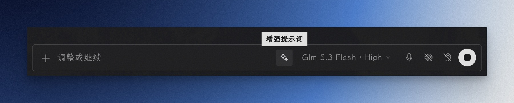

# Prompt Enhancer for Hermes

  

【Hermes 插件】把口语草稿变成可执行的结构化提示词。桌面输入框里的 ✨ 按钮，外加 `/enhance` 命令（手机 app / Telegram / 命令行）和 iOS 快捷指令 HTTP 门——四个入口，同一套模板，同一个模型设置。en / 简中 / 繁體。



## 先确认你装的是哪一版

官方目录和本仓库发的**不是同一份代码**，功能不一样，先对号：

| 来源 | 版本 | 有哪几步 | 升级方式 |
|---|---|---|---|
| 官方插件目录<br>`hermes plugins install prompt-enhancer` | **1.7.1** | 桌面按钮（⌥ 只修复） | `hermes plugins update prompt-enhancer` |
| 本仓库 main（Git 安装） | **2.5.3** | 按钮 + 快捷键 + `/enhance` + HTTP 门 | 重装 + 勾「强制重装」 |

一句话记住差别：**目录条目钉在某个已评审的 commit 上，所以永远慢一截**——下面正文按 2.5.3 写。

> ⚠️ **目录版 1.7.1 在当前版本的 Hermes 上点按钮会直接失败**（新版 Hermes 拒绝插件没有正式注册的任务名，表现为「增强失败：invalid_params」）。还在用目录版的先从 Git 装 2.4.0 以上；目录条目等 [#149288](https://github.com/NousResearch/hermes-agent/pull/149288) 合并才会跟上。

2.5.3 相比目录版多的东西：

- **修 invalid_params**：两个任务槽位（提示词修复 / 提示词增强）由插件正式注册——这是旧版在新 Hermes 上点按钮直接失败的根因
- **自定义快捷键**：设置 ▸ 键盘快捷键 里出现三行可绑定动作（详见[快捷键](#快捷键)）
- **`/enhance` 命令 + HTTP 门**：手机 app、Telegram、命令行、iOS 快捷指令都能用（详见[/enhance 命令](#enhance-命令)）
- 目录用户另外没有这些 2.2–2.4 的修正：⌘ 选模型、取消后不再补发 429 重试、输出上限按输入自适应、多输入框隔离加固

> 目录实际版本以插件卡片显示为准；本页写于 2026-11-07。

## 它做什么

输入框控件行里、模型选择器左侧多一个 ✨：

- **点一下**：草稿先被校对（错别字、同音词误换、语音口误），修好的样子**原地写回输入框**给你看见；紧接着改写——按「输出形式 → 验收判据 → 上下文 → 步骤」的顺序只补最缺的一两层，原文已经写清楚的部分不重复、不注水。
- **再点一下**（图标变成 ↩）：回到你原来打的那版，错别字也一并回来。只有一层，不经过中间态。
- **只改装写、不回答问题**：不替你执行任务，只把意图整理成 AI 更好执行的提示词。**不往会话里写任何东西**。每次点击会**只读**一次本会话历史，从中抽最多 30 个专有名词（文件/产品/标识符）拼给修复那一步，用来判断同音误写；令牌、提交哈希、版本号会被排除。⇧ 点击才会额外带上上一轮对话。语言跟随输入。

第一步（修复）是独立调用：**增强失败时你手里仍是一份干净的草稿**。

## 安装

| 方式 | 怎么做 | 装到哪版 | 装完还要做什么 |
|---|---|---|---|
| **从 Git 安装**（推荐） | 对 Hermes 说：`从 Git 安装这个桌面插件：https://github.com/Heybinshao/prompt-enhancer，安装好后并打开插件`<br>或点「技能与工具 → 插件」页面上方的「从 Git 安装」 | 仓库当前提交 | ⌘Q 重开 → 到 **技能与工具 → 插件 → Prompt Enhancer** 打开它 |
| **官方目录** | `hermes plugins install prompt-enhancer` | 1.7.1（新版 Hermes 上不可用，见上方警告） | 同上 |

**装完按钮没出现**：几乎都是没打开。包管理安装（目录 / Git）的桌面副本默认是关的——不加载、也不报错，只是静默不出现，去 **技能与工具 → 插件 → Prompt Enhancer** 点亮。

> ⚠️ 插件入口在仓库的 `desktop/` 子目录里，别把整个仓库 clone 进 `~/.hermes/desktop-plugins/`——多出一层目录，Hermes 就找不到入口文件了。

**卸载**：在「技能与工具 → 插件」里关掉开关；彻底删是 `hermes plugins remove prompt-enhancer`——桌面端下次启动会自动清掉 `~/.hermes/desktop-plugins/prompt-enhancer/` 那份副本，不用手动删。

## 使用（桌面）

| 动作 | 现在会发生什么 |
|---|---|
| 点 ✨ | 修复草稿 → 重写成结构化提示词 |
| 再点一次（↩） | 恢复你打的原版（含错别字） |
| ⌥ 点击 ✨ | **只修复，不增强**——适合只想清错字的时候 |
| ⇧ 点击 ✨ | 同普通点击，但**带上上一轮对话**当只读参考（草稿里的「按刚才那个改」能读懂一点，但上文不会被搬进结果） |
| ⌘ 点击 ✨ | **打开模型菜单**：点一行 = 固定用它，底部「恢复默认」= 回主模型 |
| 转圈时点一下 | 取消（迟到的结果自动丢弃） |
| 等待期继续打字 | 不覆盖你的手改，提示「草稿已变动」 |
| 等待期切到别的会话 | 结果不丢——回到这个会话时**自动写入**，不用再点（期间草稿被你手改过就整体放弃） |
| 空输入框点 ✨ | 提示没有可增强的内容 |
| 发送消息后 | 按钮自动回到空闲态 |

- **⌥ / ⇧ 只在空闲态生效**：已修复 / 已增强 / 结果就绪 / 转圈中时，点它只有一个意思（回退、取消或写入），加修饰键不会变成另一个动作。
- **⇧ 默认关着**：带上文会让这次调用从「只看草稿」变成「看得到上文」——万一模型把上文复述进结果，主模型会把它当成你新说的话。所以只在你主动加 ⇧ 时才带，且提示词里明确「只读不搬」。
- **引用标记有两道闸**：`@file:` 这类引用，以及 `/命令`（行首的调用、行内任意位置的 `/skill` 引用）会先被程序校验，改写结果丢了就**不写回**（提示「改写结果丢了引用标记，已保留你的草稿」），不会让你的引用静默消失。
- **每个输入框状态独立**：多会话并行时互不干扰，取消不作废别的会话；增强结果只写回发起请求的那个输入框，不会落到你当前点开的另一个会话里。
- 悬停气泡只显示当前状态，所有操作都在上面这张表里。

## 快捷键

**设置 ▸ 键盘快捷键** 里会出现三行（composer 分类）：

| 动作 | 等价手势 |
|---|---|
| 增强提示词：先修复再增强 | 点 ✨ |
| 增强提示词：仅修复输入 | ⌥ 点 ✨ |
| 增强提示词：附上一轮上下文 | ⇧ 点 ✨ |

- 默认**全部未绑定**——不绑定就完全不生效，行为与没有这项功能时一致。
- 点行 → 按下你想要的组合键即可，和官方快捷键同一套改键与持久化，重启保留。
- 变体与 ⌥/⇧ 点击同一语义：只在空闲态走变体分支；非空闲时等于按了那个手势的按钮（单一含义）。
- 需要较新的桌面版（提供插件快捷键注册之后的版本）；旧版没有这几行，按钮照常用。

## /enhance 命令

手机 app、Telegram、TUI、桌面输入框都能发——手机客户端不加载桌面插件，这条命令就是移动端的入口：

```
/enhance <草稿>        先修语音/打字错字，再改写（两次调用，约 10–20 秒）
/enhance fix <草稿>    只修错字，不改写（一次调用，最快）
/enhance raw <草稿>    只改写，跳过修错字
/enhance copy <草稿>   同 both，结果包成代码块（客户端给代码块配了复制按钮时可一键复制）
```

- 同一套提示词模板、同一个模型设置（与桌面按钮共用，见[换模型](#换模型)）。
- 草稿超过 8000 字符会被拒绝，提示分段发送。

**iOS 快捷指令 HTTP 门**：`/enhance` 需要打字，快捷指令不用——

```
GET  /api/plugins/prompt-enhancer/ping        验连通（无模型调用）
POST /api/plugins/prompt-enhancer/enhance     body: {"text": "...", "mode": "both|fix|raw"}
```

分享菜单、轻点背面、主屏图标都能当入口。地址在本机或远程（`https://<你的 Hermes 地址>/api/...`）都行，认证走 Hermes 自己的登录，与其它接口一致。

## 换模型

⌘ 点击 ✨ 打开 Hermes **官方模型目录**（搜索、provider 分组、收藏全部继承当前 profile），插件不自带清单。

**选中即生效；修字和重写都用它。不选就都用主模型。**

状态行两行，一行一个事实：

| 未固定 | 已固定 |
|---|---|
| `当前增强：默认主模型`<br>`<你的主模型>` | `当前增强：自定义模型`<br>`<provider> · <模型名>` |

- 点一行 = 把选择**写进 `config.yaml`**（`auxiliary.prompt_repair` + `auxiliary.prompt_enhancement`），下一次点增强就走它——**立刻生效，不用重启**。
- **恢复默认** = 清掉这两个键，回到主模型（这一条常驻，没固定时置灰）。
- 同一份配置也在 **设置 → 辅助模型** 里出现（提示词修复 / 提示词增强两行）——两个入口改的是同一份，互相看得见。

**两个入口的分工**：插件菜单 = 快速把**两步一起**钉到同一个模型（正在打字时顺手换）；设置页 = **两步分开钉**不同模型，以及统一管理其它辅助任务。

**高级：两步用不同模型**——在设置页分别配，或在 `config.yaml` 里写：

> 注意：插件菜单里选模型会把这两个键**同时写成同一个值**，覆盖你的分步配置；点「恢复默认」只是清空回到主模型，不会还原你写过的分步配置——要用分步就重新填一次。

```yaml
auxiliary:
  prompt_repair:          # 第一步：修复，建议用快的模型
    provider: <provider 名>
    model: <模型名>
  prompt_enhancement:     # 第二步：增强，建议用强的模型
    provider: <provider 名>
    model: <模型名>
```

⚠️ 这两步的 `timeout` 键**不生效**：单次调用硬顶 60 秒，配了也被忽略。

## 边界与限制

**修复**

- 判据是「**整句在语境里通不通**」，不是「这个词本身对不对」。语音输入最常见的错不是写错字，而是把词换成了另一个**合法**同音词（「会话」→「绘画」）。只改让整句讲不通的地方：错别字、同音词误换、口误漏字多字、缺失标点；不改风格、不润色、不扩写。
- 它有边界：草稿越短、语境越专有，判断依据越少——只打一句「绘画的事怎么弄」这类仍会放过。源头在语音识别，换更强的识别模型能从根上减少。
- **三道闸门**，任一不过就丢弃修复稿、用原文继续增强：长度漂移 > 15%（下限 8 字符）判为在重写；原文的 `@file:` 等 chip 与 `/命令`（行首调用、行内 `/skill` 引用）必须逐字保留；空结果 / 与原文相同则静默跳过。
- 带 `@` 引用 chip 的草稿**整段跳过修复**（chip 是机器文本，没有可校对的东西）；带 `/skill` 引用的草稿不跳过，靠上面的 token 闸兜底。短于 8 字符（没东西可修）或超过 2000 字符也跳过（长草稿基本不是语音输入，直接增强更快）。
- 修复调用失败（含限流）时静默降级，用原文继续增强。

**增强**

- 草稿超过 8000 字符不支持。
- **输出上限按输入自适应**：`max(800, min(2000, 输入长度 × 0.6))`——短草稿仍是 800，长草稿不会被压成摘要；`max_tokens` 同步放宽，避免「写满了却被截断」。
- 每次模型调用硬顶 60 秒；桌面按钮两步串行，最坏约 2 分钟；`/enhance` 同理。
- **取消即停**：转圈时点一下取消后，迟到的结果丢弃，正在退避的 429 重试也不再发。
- 草稿里已有的 `@引用` / `/命令`（含行内的 `/skill`）pill 原样保留（图标、配色与官方一致）；改完由程序再核对一遍 token，丢一个就整次不写回、草稿原样留着。
- 429（瞬时限流）自动退避重试 3s / 5s 各一次，气泡显示「限流重试中…」；仍失败就稍等几秒再点。
- 需要在线（走 one-shot 通道）。
- ⌘Z 撤销的是打字历史，撤销不了增强替换——恢复原文用按钮。

## 工作原理

一个插件，两个运行时，四个入口：

- **桌面半边**（`desktop/plugin.js`）注入官方 `composer.actions` 贡献区；草稿读写全部走官方接口（按会话寻址，`@引用`、行首 `/命令` 和行内 `/skill` 引用都由应用自己水化成 chip；SDK 答不上来就提示用户，绝不伸手进应用 DOM）。三个快捷键动作通过 keybinds 贡献区注册进 **设置 ▸ 键盘快捷键**，绑定与持久化由 Hermes 自己管理。
- **主机半边**（`__init__.py` + `dashboard/`）注册两个辅助任务槽位和 `/enhance` 命令，并提供 `POST /enhance` HTTP 门——四个入口共用同一份模板与模型配置。
- 桌面两次调用都是一次性 one-shot（除了修复那步的名词表，不带会话历史）：先 `prompt_repair` 修字并写回，再 `prompt_enhancement` 重写。写回前做快照比对，草稿在等待期被手改就放弃应用——绝不覆盖用户的字；修复稿的原始备份只记一次，所以「恢复原文」永远回到你打的那一版。
- 请求本身不带模型参数——从 `config.yaml` 的 `auxiliary.prompt_repair / prompt_enhancement` 读；请求带会话作用域，并在点击那一刻一次定型。
- 写回失败（比如增强进行中切走了那个会话）时结果不会被丢弃：回到发起请求的会话那一刻**自动写入**；写入前重新核对草稿，期间被手改过就整体放弃。

> 纯 SDK 实现 + `requires_hermes: ">=0.21.6"`：低于此版本的 Hermes 不会安装（旧版桌面端的 DOM 读写兼容层已删除，见目录 PR [#121246](https://github.com/NousResearch/hermes-agent/pull/121246)）。

## 反馈

装上用着有问题（哪怕看不懂的报错）欢迎[提 issue](https://github.com/Heybinshao/prompt-enhancer/issues/new)——附上 `~/.hermes/logs/desktop.log` 里 `[prompt-enhancer]` 开头的行即可，不用截图也不用复现步骤。也可以到微信公众号「宝藏彬少」后台留言。

## 关于作者

**彬少** —— 一个什么都折腾一下的人：装系统 · 玩 AI · 搭知识库 · 做设计。这个仓库里的东西都是自己的卡点长出来的，日常在用，做完就开源。

微信公众号 **「宝藏彬少」**：折腾，是为了更好用。

## 许可证

[CC BY-NC 4.0](LICENSE) © 2026 Binshao
